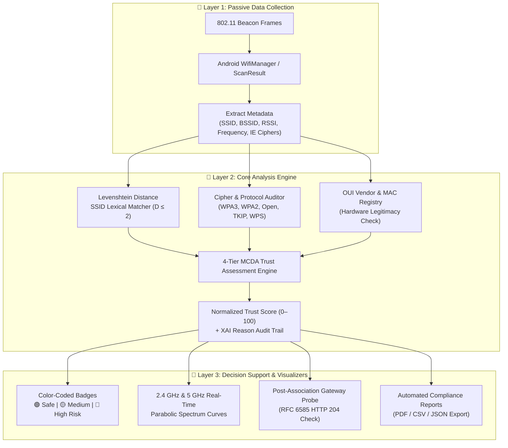
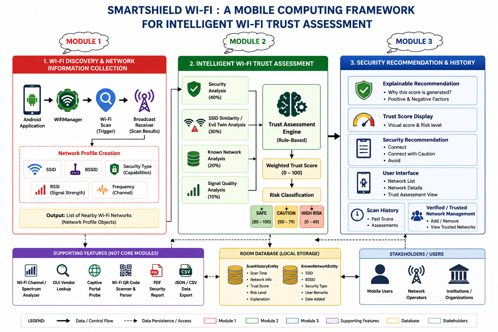
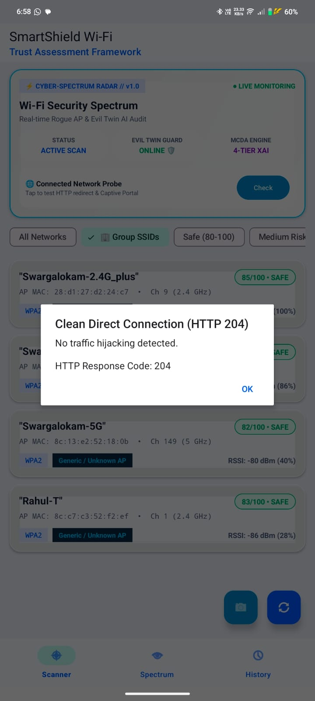
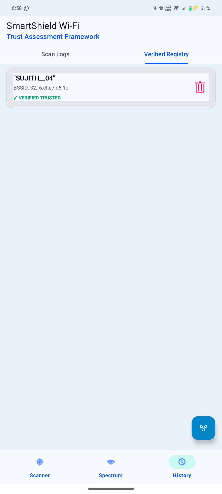
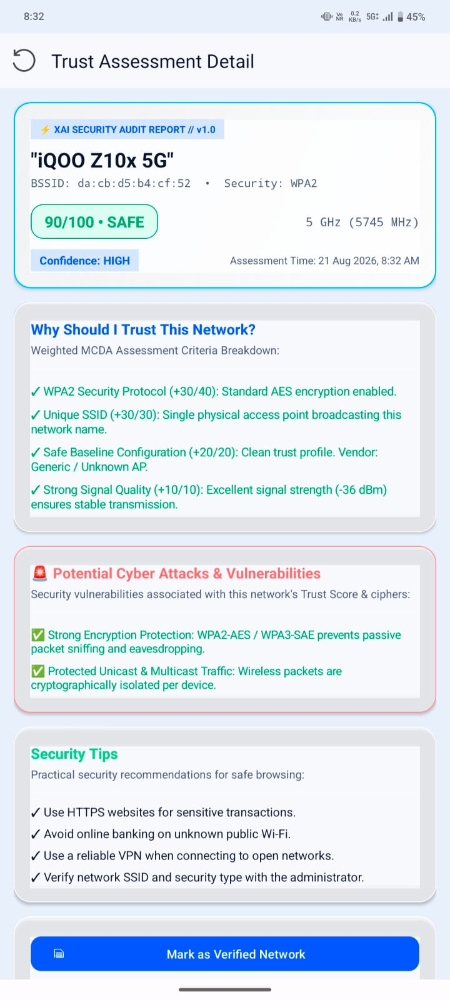
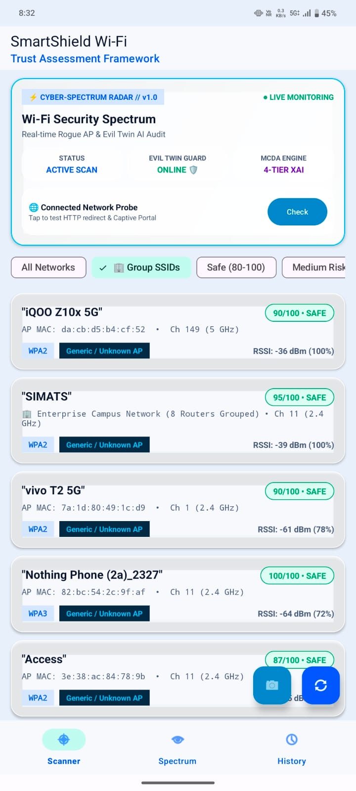
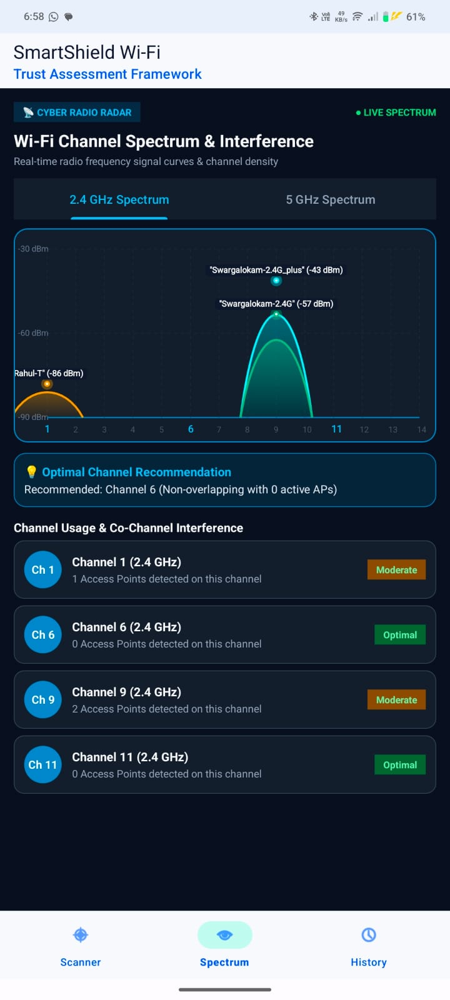
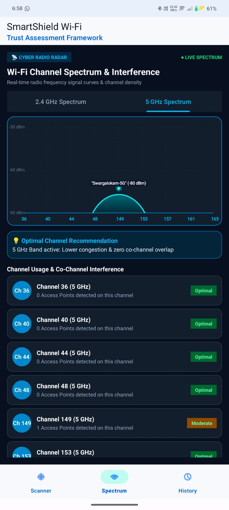

<div align="center">

# 🛡️ Smart Shield Wi-Fi
### *An Explainable Mobile Computing Security Framework & Intelligent Wi-Fi Trust Assessment System*

[-3DDC84?style=for-the-badge&logo=android&logoColor=white)](https://developer.android.com)
[](https://www.java.com)
[](https://gradle.org)
[](https://streamlit.io)
[](#)
[](#)

<br/>

**SIMATS ENGINEERING**  
**Saveetha Institute of Medical and Technical Sciences (SIMATS)**  
*Department of Information Technology / Electronics & Communication Engineering*  
**Course**: ITA0330 — Mobile Computing | **Academic Year**: 2026  

---

### 👥 Project Team & Supervision

| Team Member | Registration No. | Engineering Role | Key Contributions |
| :--- | :---: | :--- | :--- |
| **T. Sanhith** | **192311228** | **Project Lead & Core Security Architect** | Trust Assessment Engine, Evil Twin Levenshtein Module, JUnit Test Suite |
| **P. Veeraswami** | **192311253** | **Spectrum & Presentation Specialist** | Canvas Parabolic Spectrum Visualizer, Room DB Schema, Literature Review |
| **P. Jawed Khan** | **192311263** | **Gateway Probing & Analytics Lead** | RFC 6585 HTTP 204 Probe, ZXing QR Auditor, PDF Exporter, Streamlit App |

**Faculty Supervisor**: **Dr. Meganathan Elumalai, Ph.D.** — *Professor, SIMATS Engineering*

---

</div>

## 📌 Executive Summary

Modern mobile operating systems connect blindly to Wi-Fi access points based solely on nominal SSID labels and raw signal strength (RSSI), exposing mobile users to severe wireless threat vectors such as **Evil Twin attacks**, **rogue access points**, **SSID spoofing**, and **phishing captive portals**. 

**Smart Shield Wi-Fi** is an on-device, rule-based **Explainable AI (XAI)** mobile security assistant. It intercepts 802.11 beacon frames passively before network connection, applies a **Multi-Criteria Decision Assessment (MCDA)** scoring engine (0–100), and presents users with human-readable, transparent explanations: *"Why should I trust this network?"*.

---

## 🏗️ System Architecture



<div align="center">
  
  <p><em>Figure 1: Smart Shield Wi-Fi End-to-End System Architecture</em></p>
</div>

---

## 🌟 Key Security Capabilities

### 1. 🧮 4-Tier MCDA Trust Scoring Engine
Every discovered access point is evaluated against a weighted multi-criteria formula:

$$\text{Total Score} = \text{Security (40)} + \text{Similarity (30)} + \text{Vendor/Registry (20)} + \text{Signal (10)}$$

* **Wireless Encryption (40 pts)**: WPA3 SAE (+40), WPA2 AES (+30), Legacy WPA (+15), Open (0 pts). Deductions applied for insecure TKIP ciphers (-10 pts) and WPS PIN brute-force exposure (-5 pts).
* **SSID Integrity & Similarity (30 pts)**: Verified unique physical AP (+30 pts); multi-AP enterprise roaming (+15 pts); Evil Twin suspect (0 pts).
* **Known AP & Hardware Vendor (20 pts)**: Resolves MAC OUI prefixes against vendor databases; flags known penetration testing hardware (WiFi Pineapple, softAP).
* **Signal Quality (10 pts)**: Ensures reliable radio frame transmission based on RSSI dBm levels.

---

### 2. ⚔️ Evil Twin & Lookalike Spoofing Guard
* Employs the **Levenshtein Distance** string metric:
  $$\text{Levenshtein}(s_1, s_2) \le 2$$
* Detects lookalike SSIDs (e.g., `Campus_Guest` vs `Campus_Guest_Free`).
* **Critical Attack Condition**: If two nearby APs share identical or similar SSIDs but present mismatched security ciphers (e.g., one WPA2-Enterprise and one OPEN), the engine immediately triggers a **Critical Evil Twin Alert** and drops the similarity score to **0 / 30**.

---

### 3. 🌐 Active Gateway & Captive Portal Probe
* Dispatches asynchronous RFC 6585 HTTP checks to `http://connectivitycheck.gstatic.com/generate_204`.
* **Clean Connection**: Returns **HTTP 204 No Content** (uninhibited direct internet routing).
* **Traffic Hijacking**: Catches HTTP 302/redirect headers, warning the user of potential SSL-stripping proxies or fake login captive portals.

---

### 4. 📊 2.4 GHz & 5 GHz Parabolic Spectrum Analyzer
* Renders real-time mathematical parabolic curves representing radio channel bandwidth and signal attenuation.
* Identifies co-channel and adjacent-channel interference across channels 1–14 (2.4 GHz) and channels 36–165 (5 GHz).
* Recommends optimal, non-overlapping channels (1, 6, 11) for maximized throughput.

---

## 📱 Application User Interface & Visual Results

<div align="center">

| 📡 Live Spectrum Scanner | 🔍 Explainable AI (XAI) Audit |
| :---: | :---: |
|  |  |
| *Color-coded trust score cards (Safe / Medium / High Risk)* | *Detailed reason breakdown explaining point allocations* |

| 📈 2.4 GHz Spectrum Analyzer | 📶 5 GHz Channel Interference |
| :---: | :---: |
|  |  |
| *Parabolic curves showing 2.4 GHz channel overlap* | *High-frequency 5 GHz band congestion analysis* |

| 🌐 Gateway Probe (HTTP 204) | 📷 Safe QR Code Scanner |
| :---: | :---: |
|  |  |
| *Active probe verifying clean direct routing* | *Pre-connection Wi-Fi QR credential inspection* |

</div>

---

## 📁 Repository Deliverables

```
Capstone project/
├── SmartShield-Wifi.apk                                 # Compiled Android Debug Application (~6.28 MB)
├── Capstone_Project_Report_SmartShield_WiFi.docx        # Full Capstone Project Report (Sep 2026 Format, ~6 MB)
├── MC-ppt.pptx                                          # Presentation Slide Deck (17 Slides, ~6.38 MB)
├── Capstone Project Report - New Format - Sep 2026.pdf  # SIMATS Engineering Official Report Format
├── report_assets/                                       # High-resolution diagrams and UI screenshots
└── Smart Shield Wifi/                                   # Full Source Code
    ├── app/                                             # Native Android App Module (Java, MVVM, Room DB)
    │   ├── src/main/java/com/smartshield/wifi/          # Application Domain, Data & Presentation Logic
    │   └── src/test/java/com/smartshield/wifi/          # Automated JUnit Test Suite (100% Pass)
    ├── streamlit_app.py                                 # Desktop Cyber-Radar Analytics Application
    ├── web/                                             # Lightweight Standalone Web Dashboard
    └── ARCHITECTURE_DESIGN.md                           # In-depth Technical Architecture Specification
```

---

## 🚀 Quickstart & Installation

### Option 1: Install APK Directly on Android Phone
1. Download [SmartShield-Wifi.apk](SmartShield-Wifi.apk).
2. Transfer to phone via USB, WhatsApp, or Drive.
3. Open the file and tap **Install** (enable *"Install unknown apps"* if prompted).
4. Grant **Location** and **Nearby Wi-Fi Devices** permissions.

### Option 2: Build from Source (Android Studio / Gradle)
```bash
# Clone the repository
git clone https://github.com/Sanhith30/ITA0330-Mobile-Computing.git
cd "ITA0330-Mobile-Computing/Capstone project/Smart Shield Wifi"

# Run automated JUnit unit tests
./gradlew test

# Compile and package the debug APK
./gradlew assembleDebug
```

### Option 3: Launch Companion Streamlit Dashboard
```bash
cd "Capstone project/Smart Shield Wifi"
pip install streamlit
streamlit run streamlit_app.py
```

---

## 🧪 Automated Testing & Verification

SmartShield Wi-Fi includes a comprehensive JUnit test suite verified with **100% pass rate** across all build tasks:
* `TrustAssessmentEngineTest`: Validates scoring boundaries for WPA3, WPA2, Open networks, and security penalties.
* `EvilTwinDetectorTest`: Validates detection of lookalike SSIDs and security protocol mismatches.
* `StringSimilarityUtilTest`: Tests Levenshtein distance calculations against edge cases.
* `OuiVendorLookupTest`: Validates MAC address hardware manufacturer resolution.
* `WifiQrParserTest`: Verifies decoding and validation of Wi-Fi QR code payloads.

---

## 📜 References & Engineering Standards

1. **IEEE Std 802.11-2020**: Wireless LAN MAC and Physical Layer Specifications.
2. **Wi-Fi Alliance (2020)**: *Wi-Fi CERTIFIED WPA3™ Security Specification*.
3. **NIST SP 800-53 Rev. 5 (2020)**: *Security and Privacy Controls for Information Systems*.
4. **RFC 6585 & RFC 7664**: *Hypertext Transfer Protocol Additional Status Codes & Dragonfly Key Exchange*.
5. **Sun, Liu, & Wang (2022)**: *Machine Learning-Based Wi-Fi Security Assessment for Mobile Networks*, IEEE Access, vol. 10.

---

<div align="center">
  <sub>Developed for ITA0330 Mobile Computing Capstone Evaluation · SIMATS Engineering, Chennai</sub>
</div>
